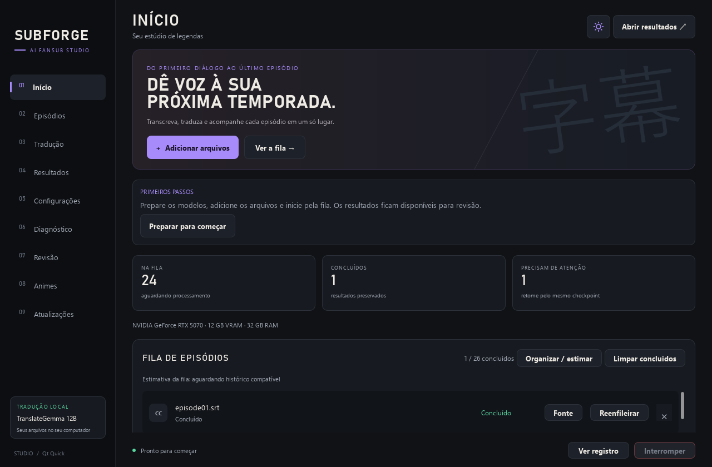

# SubForgeAI Studio

Aplicativo para Windows voltado à criação e revisão de legendas de anime, com processamento local.

## Baixar e começar

**[BAIXAR INSTALADOR PARA WINDOWS](https://github.com/Fernandobaruck/SubForgeAI/releases/download/v1.0.2/SubForgeAI-Instalar-1.0.2.zip)**

[Ver todos os downloads e notas da versão](https://github.com/Fernandobaruck/SubForgeAI/releases/latest)

1. Baixe **SubForgeAI-Instalar-1.0.2.zip**, extraia e abra **Instalar.cmd**.
2. Escolha uma pasta e aguarde. O instalador baixa, verifica e prepara o aplicativo sem pedir instalação de Python, Qt, Ollama ou FFmpeg à parte.
3. No Studio, clique em **Preparar para começar** e baixe os modelos que deseja usar. Depois, adicione seus arquivos e inicie pela fila.

**Já usa o Studio?** Atualize pela aba **Atualizações**. O arquivo `SubForgeAI-update-*` é destinado a instalações existentes; novos usuários devem baixar o ZIP **Instalar**.

O download inicial tem aproximadamente **5,8 GB** e ocupa cerca de **9,6 GB** instalado, sem modelos e sem dados pessoais. É necessário espaço temporário adicional durante a instalação. As partes `.bin` da release são baixadas automaticamente pelo instalador. Não é necessário baixá-las manualmente. O botão **Code → Download ZIP** baixa apenas o código para desenvolvimento.

[Guia passo a passo e solução de problemas](docs/PRIMEIROS-PASSOS.md) · [Reportar problema](https://github.com/Fernandobaruck/SubForgeAI/issues)



## O que preciso?

- Windows x64 e internet para a preparação inicial. O pacote e o instalador precisam de espaço temporário; o instalador verifica isso antes do download.
- TranslateGemma 12B: cerca de **8,1 GB** adicionais. Whisper Turbo: cerca de **1,6 GB**; Large v3: cerca de **3,1 GB**. Você escolhe quais baixar.
- A configuração de referência do projeto é **RTX 5070 12 GB e 32 GB de RAM**. Velocidade e aceleração variam com o hardware. Whisper/CTranslate2 usa CUDA em NVIDIA; aceleração em AMD não é garantida.
- O processamento é local após preparar os recursos necessários. A tradução de legendas gera português do Brasil. Revise os resultados antes de compartilhar.

## Recursos

- Extração de legendas, transcrição com Whisper large-v3 e large-v3-turbo e tradução com TranslateGemma pelo Ollama.
- Fila de episódios, retomada de tradução, glossários e memória por série.
- [Glossário online opcional](community/glossary/README.md), com prévia de importação, conflitos, sugestões de IA local e contribuição revisada pelo GitHub.
- Revisão lado a lado, editor de legendas, sincronização, controle de legibilidade e exportação ASS.
- Interface Qt Quick/QML em português, inglês e espanhol, com temas escuro e claro.
- Atualizações assinadas, backup e recuperação da versão anterior.

## Código e aplicativo portátil

Este repositório contém o código-fonte, a interface, os testes e as ferramentas de desenvolvimento. Para uso normal, prefira o instalador da release, que prepara o runtime e as ferramentas automaticamente. O código do GitHub sozinho não contém esses componentes. Modelos são preparados pelo painel do Studio.

Em uma instalação portátil existente, abra **SubForgeAI Studio.exe** e mantenha `_studio_boot/`, `runtime/` e os demais componentes operacionais junto ao aplicativo. O código também pode ser iniciado pelo Python do runtime:

```powershell
.\runtime\python\python.exe -B -X utf8 studio_launcher.py
```

O ambiente atual utiliza Windows x64, Python 3.11 e Qt 6. As dependências da interface estão em [studio_ui/requirements.txt](studio_ui/requirements.txt); OCR possui dependências adicionais em [tools/requirements-ocr.txt](tools/requirements-ocr.txt). A transcrição requer faster-whisper/CTranslate2; recursos de separação de áudio requerem PyTorch/Demucs e versões de aceleração compatíveis com o hardware. Esses arquivos de requisitos não representam sozinhos todo o runtime portátil.

## Desenvolvimento e testes

Os módulos Python da raiz implementam o processamento; `studio_ui/` contém a interface; `tests/` reúne os testes; `tools/` reúne ferramentas de compilação e validação. Com o runtime preparado, execute:

```powershell
.\runtime\python\python.exe -B -X utf8 -m unittest discover -s tests -p 'test_*.py'
.\runtime\python\python.exe -B -X utf8 tests/check_package.py
```

A verificação do pacote exige o executável e os componentes portáteis. Ferramentas de integração podem exigir modelos instalados ou arquivos de mídia locais. `tools/build_studio.py` compila o inicializador com PyInstaller; feche o Studio antes de recompilar.

## Atualizações

O canal oficial é [Releases](https://github.com/Fernandobaruck/SubForgeAI/releases). Pacotes `SubForgeAI-update-*.zip` são atualizações de uma instalação existente e não incluem modelos ou runtime. Consulte [o guia de publicação](docs/RELEASES.md) e [o guia do Studio](docs/STUDIO.md).

Configurações, glossários pessoais, histórico, saídas, caches, modelos e chaves privadas ficam fora do controle de versão. A chave pública no código permite verificar os pacotes oficiais; ela não permite assinar novas versões.

## Licenciamento

Nenhuma licença de uso ou redistribuição do código foi definida pelo titular até o momento. Dependências e modelos mantêm suas próprias licenças; consulte os respectivos fornecedores antes de redistribuí-los.
