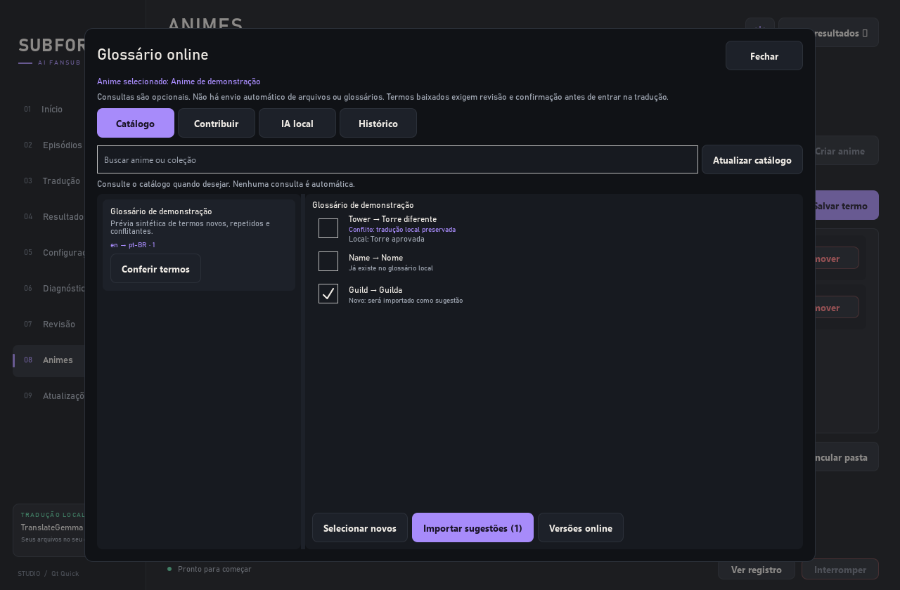

# Catálogo comunitário de glossários

O Studio consulta este catálogo somente quando o usuário solicita. A leitura não exige conta nem token. O catálogo começa com uma coleção opcional de honoríficos; glossários específicos de anime serão acrescentados após revisão das contribuições. Não considere sugestões comunitárias ou de IA como terminologia oficial automaticamente.

## Usar

No Studio: **Animes → escolha o anime → Glossário online e sugestões de IA**. Atualize o catálogo, abra uma coleção, confira os termos e marque os novos que deseja importar. Eles entram como sugestões, sem alterar traduções locais existentes. Confirme-os na aba Animes depois de revisar. Termos confirmados passam a ser usados nas próximas traduções; legendas já prontas não são reescritas automaticamente.

Conflitos mostram a versão local e preservam o termo existente. Para trocar a tradução, edite e confirme o termo local conscientemente. O cache permite consultar coleções já baixadas quando a rede estiver indisponível; ele não representa uma consulta atualizada.

## Contribuir

Na seção **Contribuir**, selecione apenas termos confirmados, confira o JSON e clique em **Revisar proposta no GitHub**. É necessário entrar no GitHub e enviar o formulário. Para propostas grandes, use **Copiar proposta** e cole no campo Termos. Não envie legendas completas, caminhos pessoais ou credenciais. Nenhum glossário privado é publicado automaticamente.

A proposta deve indicar o anime, idioma de origem e contexto/referências. Sugestões auxiliadas por IA devem ser identificadas e conferidas por uma pessoa. Não publique listas copiadas de terceiros sem permissão.

## Revisão pelo mantenedor

1. Confira significado, contexto e consistência de cada termo, inclusive diferenças entre temporadas ou adaptações.
2. Salve somente os termos aprovados em um JSON `{"terms":[{"source":"termo","target":"tradução"}]}`.
3. Use `tools/add_community_glossary.py --input proposta.json --id identificador-do-anime --title "Nome do anime" --description "Escopo e convenções" --revision 1 --source-language en`.
4. Revise os arquivos gerados e publique a coleção e o índice juntos em um commit. O script não aprova propostas nem publica sozinho.

Cada coleção tem identificador estável, revisão, idiomas e hash SHA-256 no índice. Mudanças precisam de revisão nova. O histórico público fica nos commits do GitHub; o Studio também preserva as versões locais anteriores ao importar.

Na seção **IA local**, o TranslateGemma já instalado pode sugerir uma tradução de termo em inglês ou japonês. A resposta fica para edição e aprovação local; não é enviada ao catálogo e não confirma cânone ou nomes oficiais. Não substitui uma tradução local existente.

Este catálogo depende da disponibilidade e dos limites do GitHub. Sem conexão, o glossário local confirmado continua funcionando normalmente.

